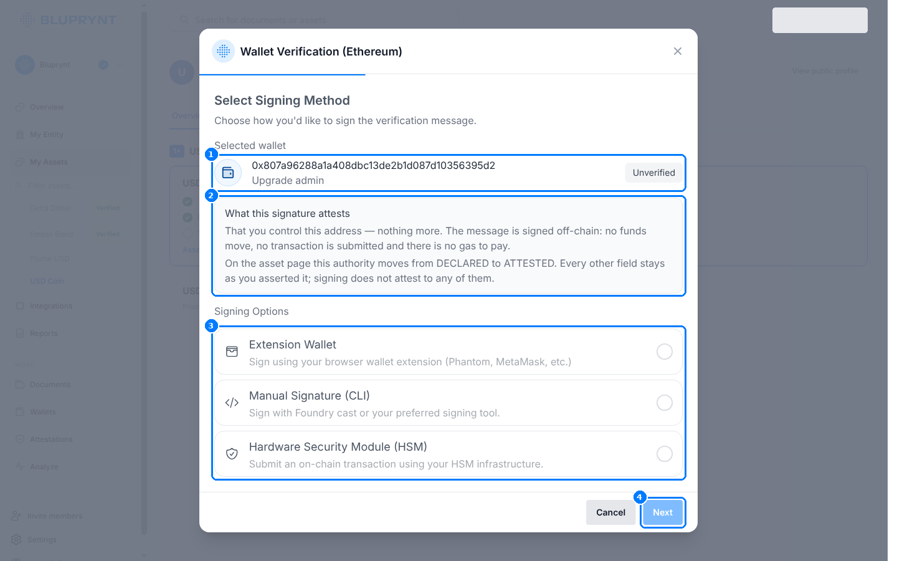
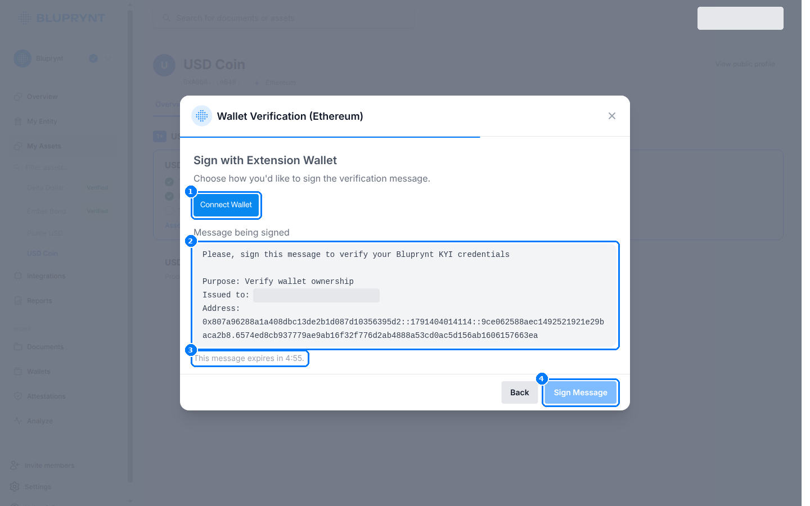
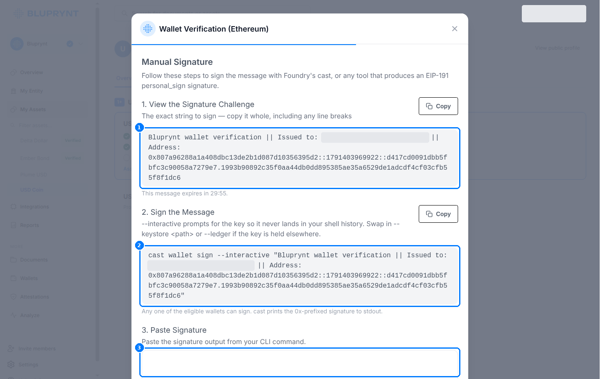
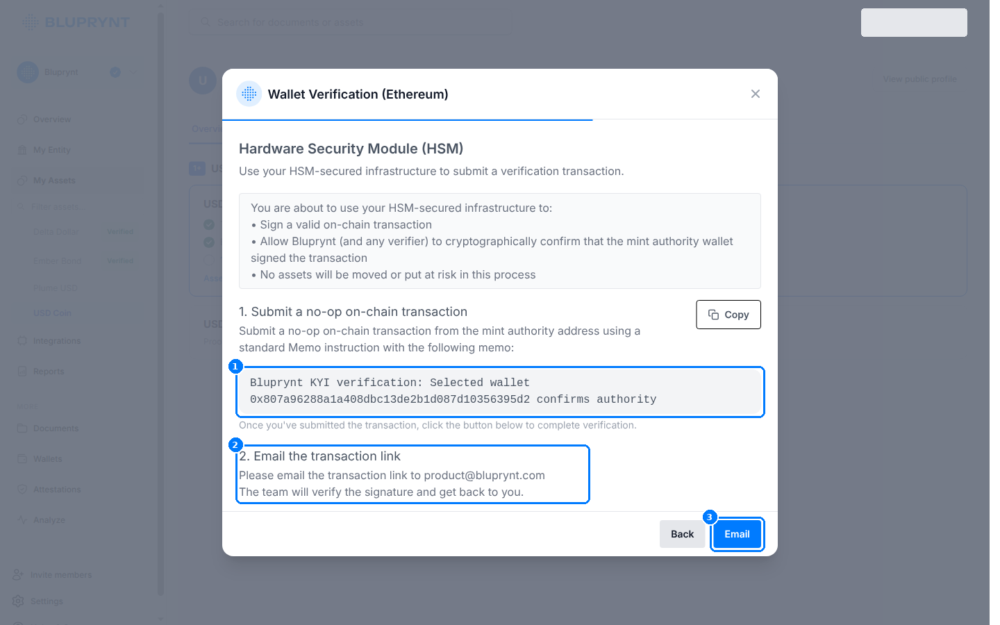
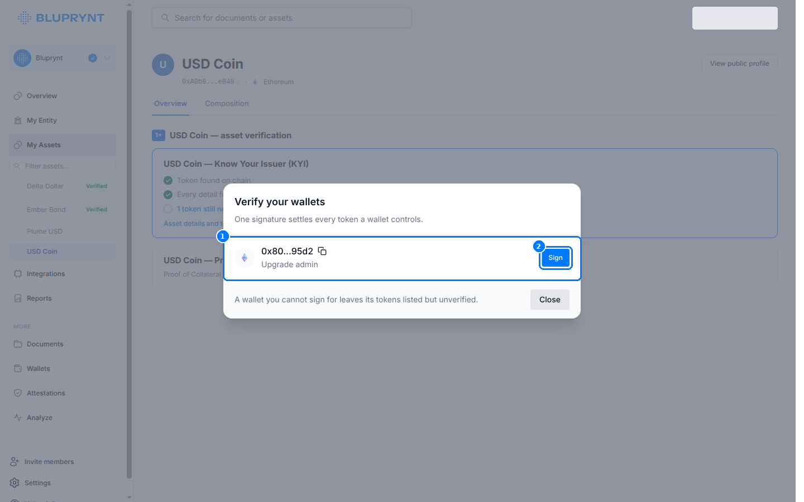

KYI verifies an asset by tying it to the organization that controls it. After [KYB](/sdk/flow#step-2-verify-the-organization-kyb) proves who the organization is, wallet verification proves the organization controls the token. A member signs once for each wallet that holds on-chain authority over the token.

## Key concepts

| Term | Meaning |
|---|---|
| **Authority wallet** | A wallet the token contract gives control to: owner, admin, minter or upgrade admin on EVM; mint authority or freeze authority on Solana; the issuing account on XRPL. Bluprynt reads these from the chain. |
| **Challenge** | A one-time message that names the wallet address and the member who requested it. |
| **Declared → attested** | Before signing, an authority is `DECLARED`: Bluprynt read it from the chain. After a valid signature, it's `ATTESTED`. Signing attests to control of the address only, not to any other field. |
| **Wallet queue** | The list of authority wallets still waiting for a signature, across all of an asset's tokens. One signature covers every token that wallet controls. |

## How it works

1. Bluprynt reads the token's contract and lists the authority wallets.
2. The member picks a wallet and a signing method.
3. Bluprynt issues a challenge that expires: five minutes for a browser wallet, 30 minutes for a manual signature, seven days for an HSM memo. An expired challenge is refreshed automatically.
4. The member signs. Most methods sign off-chain: no funds move and no gas is paid.
5. Bluprynt verifies the signature against the wallet address. Off-chain signatures are confirmed instantly. HSM memo transactions are reviewed by hand.
6. When every token has an attested authority, the member can file the asset for decision.

## How Bluprynt checks a signature

This section is the reference for how each chain family is verified. Other pages link here.

### Ethereum and L2s

The member signs an off-chain EIP-191 (`personal_sign`) message. There's no transaction and no gas.

1. Bluprynt issues a short challenge. It names the wallet address and the member who requested it.
2. The member signs it.
3. Bluprynt checks the signature against the address.

Proofs are tied to the address, not the chain. One signature covers that address on Ethereum and on every L2 where it's used. The member only signs again for an address that differs on an L2. The EVM chains are listed in [Supported chains](/supported-chains#evm-chains).

### XRPL

XRPL works the same way: an off-chain signed message, no fee, nothing written to the ledger.

1. The wallet signs the challenge and sends its public key.
2. Bluprynt checks the key belongs to the r-address, then verifies the signature.
3. If no key is sent, Bluprynt reads the signing key from the account's recent transactions on the ledger. The [manual signature](#manual-signature-cli) script sends no key, so it uses this lookup.

If the account hasn't signed a transaction recently, the lookup finds no key. Use an extension wallet instead, which sends the key.

**Regular keys.** Sign with the account's master key. A regular-key signature only verifies when no key is sent and none of the account's last 100 transactions was signed with the master key.

### Safe and other multisig wallets

Smart-contract wallets like a Safe can't sign the message, so one owner signs instead. Bluprynt doesn't verify contract signatures (EIP-1271). If a token's authority is a multisig, the queue offers two ways to prove control:

| Option | When to use it |
|---|---|
| **Signer on the multisig** | One owner signs the challenge with their own key. Any one owner is enough. Bluprynt records the proof against the multisig. |
| **The multisig itself** | The multisig sends the [HSM memo transaction](#hsm-or-custody) from its own address. Bluprynt reviews it by hand. |

### Custody setups and transaction verification

Custody setups that can't sign messages have an on-chain memo option on EVM, XRPL and Solana. Bluprynt reviews it by hand. See [HSM or custody](#hsm-or-custody).

On EVM there's also transaction verification via a small ETH transfer. See [Transaction verification](#transaction-verification).

<Frame caption="Signing methods for an Ethereum authority wallet (Bluprynt Passport; the widget shows the same dialog).">
  
</Frame>

## Methods by chain

| Method | EVM | Solana | XRPL | Signs | Confirmed |
|---|---|---|---|---|---|
| **Extension wallet** | MetaMask and other injected wallets | Phantom and other Solana wallets | GemWallet, Crossmark | Off-chain message | Instantly |
| **WalletConnect** | Mobile and desktop wallets | Mobile and desktop wallets | — | Off-chain message | Instantly |
| **Manual signature (CLI)** | `cast wallet sign` or any EIP-191 tool | `solana sign-offchain-message` | Script using `xrpl` or `ripple-keypairs` | Off-chain message | Instantly; Solana after Bluprynt review |
| **HSM or custody** | Memo transaction | Memo transaction | Memo transaction | On-chain no-op | After Bluprynt review |
| **Transaction verification** | Micro-ETH transfer | — | — | On-chain transfer | When the transaction is found |

<Note>WalletConnect and transaction verification are off by default. Bluprynt switches them on per member account. Ask your Bluprynt contact which methods your members get.</Note>

## Extension wallet

<Frame>
  
</Frame>

1. **Connect Wallet**, and switch to the authority account if the wallet opens another one.
2. Check the **message being signed**. It names the purpose, the member it's issued to, and the wallet address.
3. The message **expires** after five minutes and is refreshed automatically.
4. **Sign Message**. The wallet shows a `personal_sign` request (EVM), a message-signing request (Solana), or a GemWallet / Crossmark prompt (XRPL).

The connected account must be the authority wallet. Otherwise, the signature doesn't verify for that address.

## Manual signature (CLI)

Use this for keys in a keystore, a hardware wallet over USB, or any machine without a browser wallet.

<Frame>
  
</Frame>

1. Copy the **signature challenge** whole, including line breaks.
2. Run the command the widget shows. It already contains the challenge.
3. Paste the signature and press **Submit**.

<CodeGroup>
```bash EVM (Foundry)
# --interactive prompts for the key so it never lands in shell history.
cast wallet sign --interactive "<challenge>"
# Key elsewhere:
cast wallet sign --keystore ~/.foundry/keystores/admin "<challenge>"
cast wallet sign --ledger "<challenge>"
```
```bash Solana CLI
solana sign-offchain-message -k <path to keypair.json> "<challenge>"
```
```ts EVM (viem)
import { privateKeyToAccount } from 'viem/accounts'

const account = privateKeyToAccount(process.env.AUTHORITY_KEY as `0x${string}`)
console.log(await account.signMessage({ message: challenge })) // EIP-191 personal_sign
```
</CodeGroup>

`cast` prints a `0x`-prefixed 65-byte signature. Paste only that line. For XRPL, the widget shows a short script for `xrpl` or `ripple-keypairs` with the challenge filled in. The script sends no public key, so Bluprynt [looks the key up](#xrpl) from the ledger.

## HSM or custody

Use this when the key can't sign arbitrary messages, for example an HSM policy or a qualified custodian. It works on EVM, XRPL and Solana.

<Frame>
  
</Frame>

1. From the authority wallet, submit a no-op transaction carrying exactly this memo:
   ```text
   Bluprynt KYI verification: Selected wallet <address> confirms authority
   ```
2. Email the transaction link (block explorer URL) to [product@bluprynt.com](mailto:product@bluprynt.com).
3. Bluprynt reviews the transaction and replies. The wallet stays unverified until then.

No assets move. The transaction pays normal network fees.

## Transaction verification

On EVM, a member can also prove control by sending a small ETH transfer. It's off by default; Bluprynt switches it on per member account.

1. Bluprynt shows its verification address and an exact amount between 0.000001 and 0.00099999 ETH.
2. From the authority wallet, send exactly that amount to that address within seven days.
3. Paste the transaction hash.
4. Bluprynt checks the transaction is confirmed, comes from the authority wallet, goes to the verification address and carries the exact amount.

The transaction pays normal network fees.

## Worked example: USD Coin on Ethereum

The queue for an asset with one authority, an upgrade admin:

<Frame>
  
</Frame>

1. The member clicks **Sign** next to `0x80…95d2 · Upgrade admin`.
2. They choose **Manual Signature (CLI)** and copy the challenge.
3. They run `cast wallet sign --ledger "<challenge>"` with the admin key on a Ledger.
4. They paste the signature and press **Submit**. The authority becomes `ATTESTED` and the queue reads "Nothing left to sign for."

## Errors and limits

| Situation | What the member sees | Fix |
|---|---|---|
| Challenge expired | "This message expires in 0:00", then a new challenge. | Sign the new message. Don't reuse old signatures. |
| Wrong account connected | The signature doesn't verify for the authority address. | Switch the wallet to the authority address and sign again. |
| Edited challenge | The signature doesn't verify. | Copy the whole challenge, including line breaks. |
| No authority found on chain | "No controlling authority has been found on chain yet, so there is nothing to prove." | Check the address, or contact Bluprynt for tokens whose control sits off-chain. |
| XRPL key not found | "Could not look up the public key" for the r-address. | Sign with an extension wallet, which sends the public key. |
| Wallet you can't sign for | Its tokens stay listed but unverified. | Sign with another authority, or use HSM or custody. |

## FAQ

<AccordionGroup>
  <Accordion title="Does signing cost gas or move funds?">
    No, for extension wallet, WalletConnect and manual signatures: they sign off-chain. HSM memo transactions and transaction verification are on-chain and pay network fees. Only transaction verification moves funds: the small ETH amount.
  </Accordion>
  <Accordion title="What exactly does a signature prove?">
    Only that the signer controls the address. It doesn't attest to the asset's name, reserves or any other field.
  </Accordion>
  <Accordion title="Do I sign once per token?">
    Once per wallet. One signature covers every token that wallet controls.
  </Accordion>
  <Accordion title="Do I sign again on each L2?">
    No. EVM proofs are tied to the address, not the chain. See [Ethereum and L2s](#ethereum-and-l2s).
  </Accordion>
</AccordionGroup>

Related: [Verification flow](/sdk/flow) · [Supported chains](/supported-chains) · [KYI](/tools/kyi)
